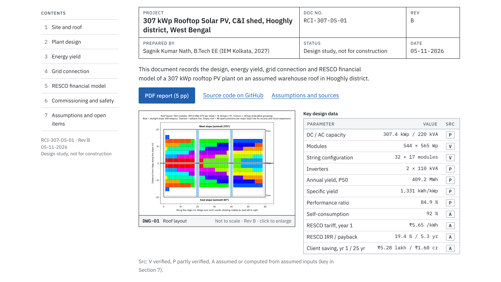
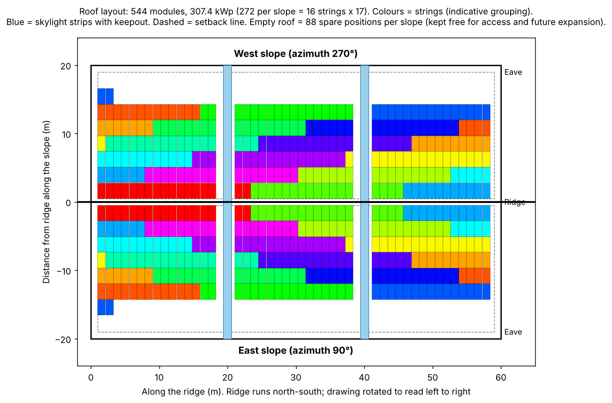
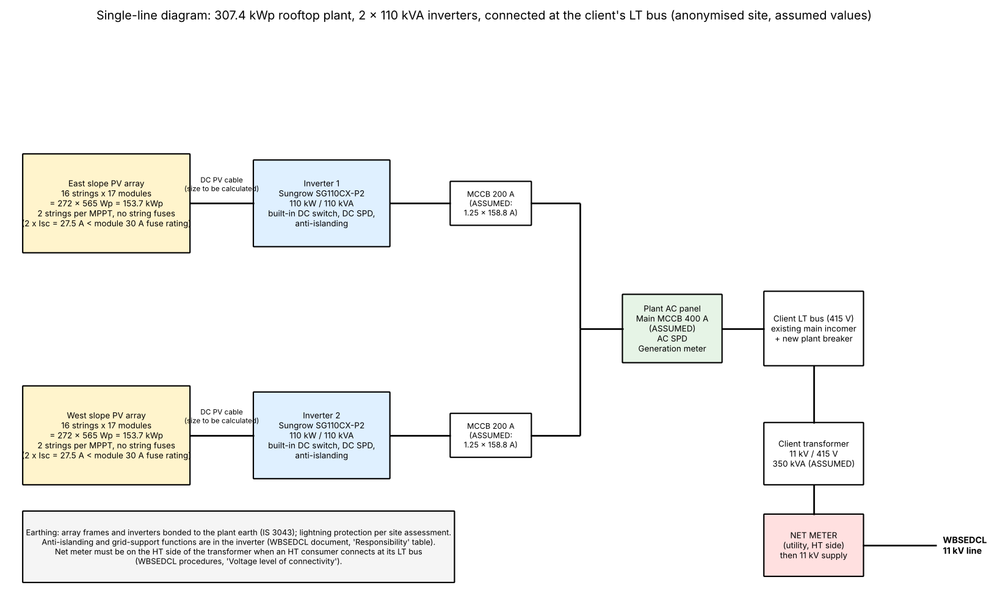
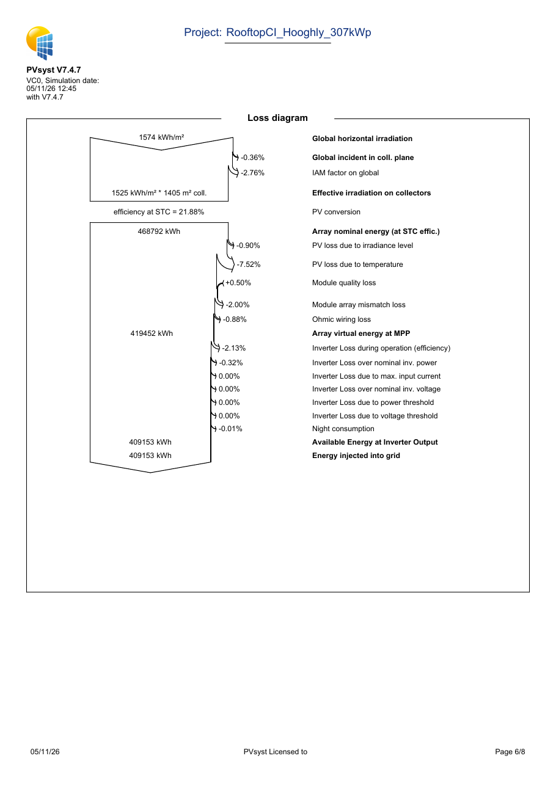
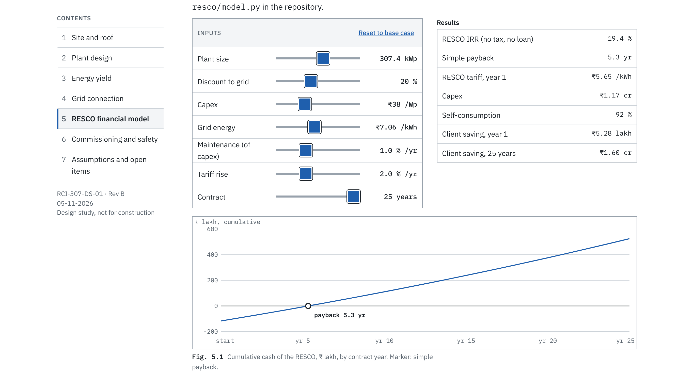
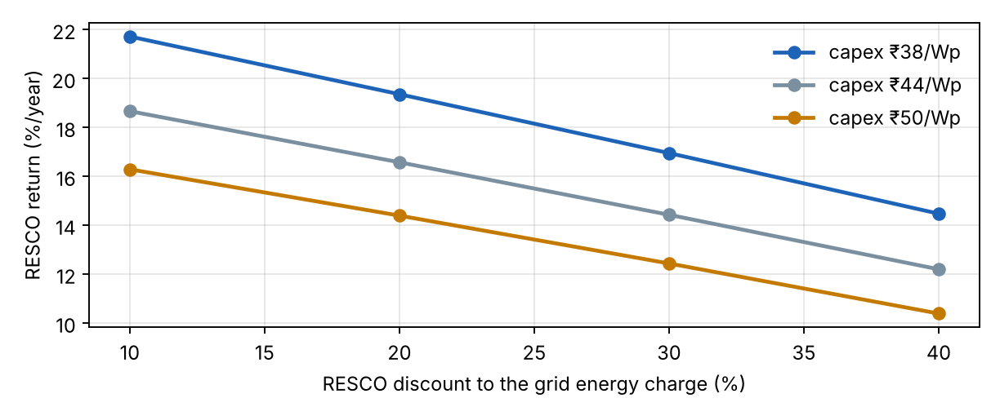
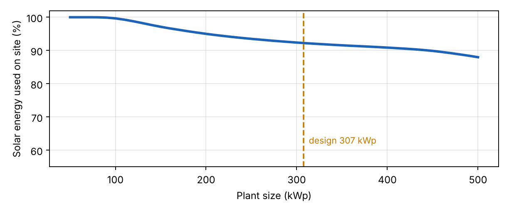

# 307 kWp Rooftop Solar PV and RESCO Model, West Bengal

**Design study RCI-307-DS-01, Rev B (5 Nov 2026).** Design, energy yield, grid connection and a 25-year RESCO financial model for a 307 kWp rooftop plant on an *assumed* warehouse roof in Hooghly district.

**Live report and calculator:** https://rooftop.sagniknath.in · [PDF report (5 pp)](report/rooftop_ci_resco_report.pdf)



> The roof and the client are assumed and anonymised. This is a design study, not a real client project, and no site survey has been done.
> Design decisions, inputs and checks are mine; AI tools assisted with scripting and documentation. There are no AI-generated images: every picture here is a drawing or a screenshot produced by the scripts and software in this repository.

## What this shows

A RESCO (renewable energy service company) pays for the plant, owns and runs it, and sells the solar energy to the factory at a discount to the grid price. This study answers the questions a site engineer and a finance team both ask of such a project:

1. What size of plant fits the roof, the grid connection rule and the factory's daytime load?
2. How are the strings, inverters and AC side arranged, and do they stay inside voltage and current limits?
3. How much energy does it make, and how much of it does the factory use?
4. What does the grid connection require in West Bengal?
5. At what tariff does the RESCO earn a sensible return, and what does the client save?
6. How is the plant commissioned and made safe?

## Key design data

| Parameter | Value | Status |
|---|---|---|
| DC / AC capacity | 307.4 kWp / 220 kVA, DC/AC 1.40 | partly verified |
| Modules | 544 × Waaree BiN-08-565 (565 Wp) | verified (datasheet) |
| String configuration | 32 strings × 17 modules (16 per roof slope) | verified |
| Inverters | 2 × Sungrow SG110CX, 110 kVA | partly verified |
| Annual yield, P50 | 409,153 kWh (PVsyst 7.4.7) | partly verified |
| Specific yield / performance ratio | 1,331 kWh/kWp / 84.9 % | partly verified |
| Used on site | 92 % (377,485 kWh); the rest is exported at ₹3.89/kWh | assumed load |
| Grid energy charge | about ₹7.06/kWh (WBSEDCL Rate E(B), 11 kV industry, FY 2025-26; MVCA extra, not included) | verified |
| RESCO tariff, year 1 | ₹5.65/kWh (20 % below grid) | assumed discount |
| RESCO IRR / payback | 19.4 % / 5.3 years (capex ₹38/Wp = ₹1.17 crore, no tax, no loan) | assumed capex |
| Client saving | ₹5.3 lakh in year 1, ₹1.6 crore over 25 years, no capital outlay | assumed |

Every value carries a status tag on the site (V verified, P partly verified, A assumed). The biggest risks are capex (installer pages, not a quotation), real yield (soiling and shading not yet modelled) and how the grid capacity cap is read (332 kWp, or about 297 kWp at a 0.85 power factor).

## Drawings

| DWG-01 Roof layout | DWG-02 Single-line diagram |
|---|---|
|  |  |

The layout is generated by [`drawings/make_layout.py`](drawings/make_layout.py) (also writes a `.dxf`), the single-line diagram by [`drawings/make_sld.py`](drawings/make_sld.py). The layout takes its geometry from `survey/roof_data.json` and `design/sizing.py`, so it follows the calculations.

## Proof of work

### Energy yield: PVsyst 7.4.7 simulation
The full 8-page report is in [`pvsyst/`](pvsyst/pvsyst_report_base_307kWp.pdf). The loss chain below is taken from it. Soiling and shading are set to zero, the weather is synthetic Kolkata data, and the licence showed 0 days remaining when the run was made; the simulation completed normally but should be repeated on a valid licence. These limits are written up in [`pvsyst/results.md`](pvsyst/results.md).



### Financial model and calculator
A Python model ([`resco/model.py`](resco/model.py)) uses PVsyst's month-by-hour output against an assumed factory load, with 25-year cash flows, degradation, escalation and IRR by bisection. The website calculator ([`site/model.js`](site/model.js)) is a line-by-line JavaScript port, and a test checks that the two agree.



| Sensitivity of RESCO IRR | Self-consumption against plant size |
|---|---|
|  |  |

Full tables, including the time-of-day tariff case (IRR 19.0 %), are in [`resco/results.md`](resco/results.md).

### Checks and tests
- 28 automated tests cover string voltage and current limits, sizing, the hourly load profile, the financial model and the website calculator against the Python model. Run with `python3 -m unittest discover -s tests`.
- String design: open-circuit voltage at the 3.4 °C record low is 931.8 V against a 1,000 V limit (18 modules would reach 986.7 V), and 25.9 A per MPPT input against a 26 A limit.
- Every external fact (tariff, regulation, price, standard) is listed with its source and access date in [`VERIFICATION.md`](VERIFICATION.md). Anything I could not source is marked ASSUMED in [`ASSUMPTIONS.md`](ASSUMPTIONS.md).
- Commissioning checklist with expected readings worked from the design, and a safety note: [`commissioning/`](commissioning/).

### A correction I made
The first version of this study read the WBSEDCL tariff table columns the wrong way round and used ₹3.84/kWh as the energy charge. The energy charge is about ₹7.06/kWh; 384 is the demand charge in ₹/kVA/month. I re-read the tariff order, fixed the model, site, PDF and documents, and logged it in `VERIFICATION.md`.

## Repository map

| Folder | Contents |
|---|---|
| `survey/` | roof data, usable area, assumed client load profile, survey checklist |
| `design/` | sizing, string design, AC side, wind-load note |
| `pvsyst/` | PVsyst project files, report and results |
| `grid/` | grid connection and regulation note |
| `resco/` | financial model (Python), results and sensitivity |
| `commissioning/` | checklist with expected values, safety note |
| `drawings/` | roof layout and single-line diagram, with generator scripts |
| `site/` | the report website with calculator (deployed from this folder) |
| `report/` | PDF report and the script that builds it |
| `docs/images/` | images used in this README |
| `tests/` | unit tests |

Progress by phase is in [`PLAN.md`](PLAN.md).

## Run it

```
python3 resco/model.py                 # base case and time-of-day case
python3 resco/write_results.py         # rewrites resco/results.md
python3 resco/export_site_data.py      # rewrites site/data.js
python3 report/make_report.py          # rebuilds the PDF (needs reportlab, matplotlib)
python3 report/make_og_image.py        # rebuilds the link-preview image and site assets (needs Pillow)
python3 -m unittest discover -s tests  # tests (the calculator test needs node)
```

## Limitations
Preliminary design only. No structural certification, no site survey, no real client data, no quotation. Wind and fire checks need a structural engineer and the fire authority. Tax, loans and inverter replacement are not modelled.

## Related work
- [5 MWp ground-mount solar plant design](https://github.com/sagnikvolt/solar-pv-plant-5mwp-wb): PVsyst, Python, AutoCAD
- [SunSense](https://sunsense.sagniknath.in): rooftop solar planner for Indian homes

## Author
Sagnik Kumar Nath, B.Tech Electrical Engineering (IEM Kolkata, 2027). [LinkedIn](https://www.linkedin.com/in/sagnikkumarnath) · [GitHub](https://github.com/sagnikvolt)
